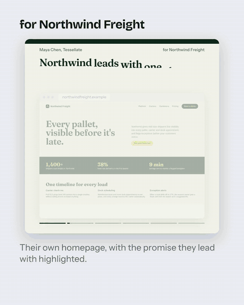
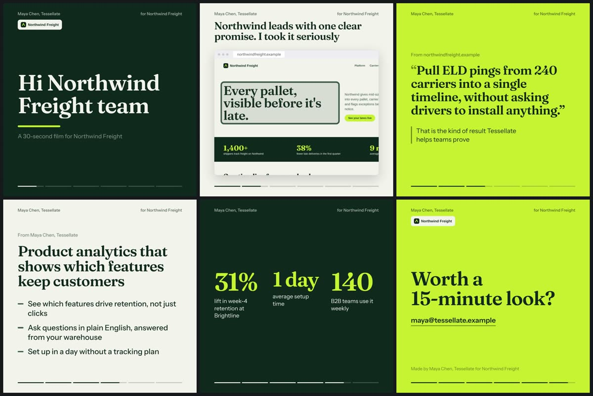
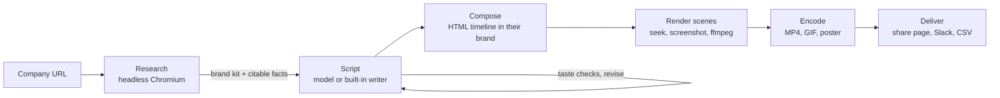
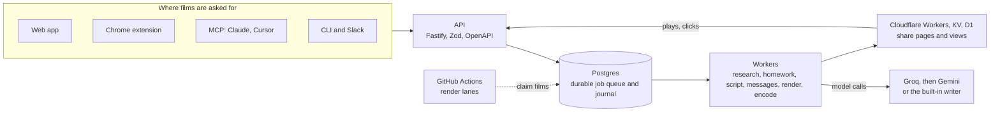
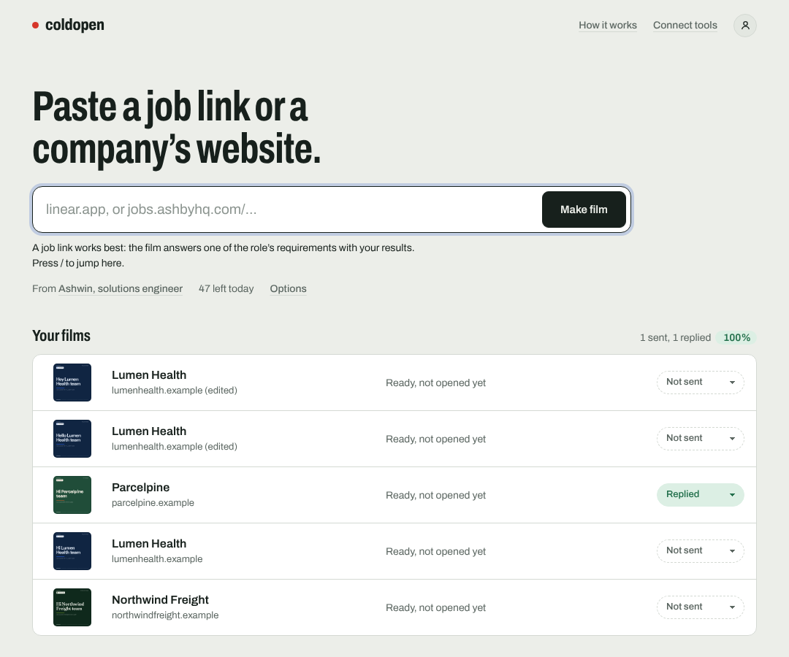

# coldopen

**Paste a company's website. Get a 30-second film made for them.**

[Try it free →](https://coldopen-nk8o.onrender.com/?ref=readme) · [Take the 90-second tour →](https://tiwaker9404.github.io/coldopen/demo/?ref=readme) · [See the films →](https://tiwaker9404.github.io/coldopen/)

> **For hiring managers.** [Take the 90-second tour](https://tiwaker9404.github.io/coldopen/demo/?ref=readme-box): the real app on a recorded account, with three films sent and real job listings, no sign-in and no waiting. Then see [how it's built](#how-its-built), [how it's measured](#quality-measured) and [who it's for and how it's positioned](docs/GTM.md).

coldopen is an open-source agent for personalized video outreach. Give it a prospect's URL and it reads their homepage, matches their brand (fonts, colors, logo), writes a short script grounded in what's actually on their site, and renders an on-brand MP4. It also produces the GIF an outreach email embeds and a share page to link to. It runs free on your own machine.



## For job seekers

**57% of about 300 films, sent by 30 people, got a reply.** One user went from a 12% reply rate to 54% and landed an offer.

- **Find the role.** Open roles from 450+ companies' public job boards, including about 400 hiring YC startups, ranked against the roles you want. Each shows its pay, a YC badge linking the founders, whether the company sponsors H-1B visas, how fast it's hiring, and who you already know there. Another ~900 YC startups post roles only on YC's Work at a Startup, which has no feed; Startups lists them, founders first.
- **Fit it.** Fit check scores how well your profile answers each post, by meaning as well as shared words ([eval](evals/fit/results.md)). Fit gaps shows the skills your best matches keep asking for, one click to add.
- **Make the film.** One click per job, or tick ten and make them all. Each film quotes a requirement from the post and answers it with your own numbers.
- **Know who to write to this week.** Network this week, on Today, lists the 10 companies most worth a film and a warm message right now, whether or not they have an opening, each with its reasons ("6 people, so the founders read their own email", "raised a round in October"). The counter shows how many companies you've reached this week against the 10-a-week target.
- **Reach the right person.** Who to reach is grouped the way networking works (founders, warm paths, people doing the job, the hiring manager, recruiting) and ordered by company size, with what to ask each group. Each LinkedIn search opens on your 2nd-degree connections, the ties that help job moves most, so you can ask for an intro. Find their email with your own free Hunter key, and the message opens as a ready draft.
- **Write like a curious person, not a job pitch.** Save your homework on each film (a detail from using their product, something you built with it, your question for them) and the drafts open with it, ask your question, and end with thanks. No job words and no numbers the film already shows. The film itself goes in the email as a playing GIF, and LinkedIn drafts show where to attach it.
- **Keep the people who replied.** Warm leads, on Today, brings back each person who replied with the next touch already drafted: a thank-you that asks who else to talk to, a short note with what you built from the conversation, a stay-in-touch note every six weeks, and a referral ask with a blurb they can forward when a role that fits opens at their company.
- **Learn what gets replies.** Half your emails open with your homework, half with your question; Today shows which one is winning. Raised in the last 3 months (from SEC Form D filings) is a filter and a badge; when the round is from the last month, the email opens by congratulating them.
- **Into your CRM.** Connect HubSpot's free CRM and each film you send becomes a company, a contact and a timeline note: sent, watched, replied, interview.
- **From your AI assistant.** coldopen is an MCP server: Claude, Cursor or ChatGPT can search jobs and YC startups, make films, draft the messages and list follow-ups for you ([setup](#use-it-from-claude-or-cursor-mcp)).
- **From any job post.** The [Chrome extension](extension/README.md) adds a Make film button to Greenhouse, Lever, Ashby, LinkedIn and YC job posts.
- **Follow up, then prepare.** A follow-up comes due a week later for a job seeker (4 days for a seller), or sooner when they watch without replying. Today's count includes every follow-up and warm-lead touch that's due, and the call sheet only says "Nothing waiting on you" when there's neither. When they reply, you get a brief for the call: the company, where you fit, the questions they'll likely ask with your answers from your own record, and three questions to ask. Copy it as prep notes in one click.

## See it work

```bash
pnpm install
pnpm film https://acme.com --profile profiles/sales.example.json
```

About a minute later:

```
Acme (acme.com), 29.2s square film
  film     films/acme.com-3f2a1c/film-square.mp4
  gif      films/acme.com-3f2a1c/preview.gif      <- paste into an email
  poster   films/acme.com-3f2a1c/poster.jpg
  sheet    films/acme.com-3f2a1c/contact-sheet.jpg
```

Each film is six scenes:

1. **Hook:** greets the company by name, on their own colors.
2. **Their homepage:** a screenshot of their site, zooming in on the promise they lead with and highlighting it.
3. **The best thing they've published:** quoted verbatim (often a number) from their homepage, changelog, blog, engineering posts, podcast notes, news or docs, set in their typeface, with where it's from underneath ("From their changelog, Oct 2026"). Only lines that make sense to a stranger are quoted ([the rule](docs/TASTE.md#grounding)). The line under it makes sense alone too: for a job seeker, it names what the fact is about and where you'd start ("Parcelpine's returns are where I'd start: one view of every event").
4. **The pitch:** what you offer, tailored to them. For a job seeker, two or three ideas for their product, each backed by one thing you actually did ("I'd stream carrier check-ins into one live view — like the containerized ETL I built").
5. **Your proof:** shown word for word from your profile, each card saying what you did, where, and what changed.
6. **One clear ask.** When you built the tool that made the film, a small line under it says so ("Made with coldopen, which I built").



## Why it doesn't look like a template

- **It uses their brand, not yours.** coldopen opens the site in headless Chromium and reads what is actually rendered:
  - colors, weighted by how much of the screen they cover and how prominent the buttons are
  - the real @font-face files behind the headline, embedded into the film
  - the logo from the header
  - the hero screenshot, plus the exact position of the headline on it
- **It can't invent facts.** The model writes short lines and picks pointers: which fact from the site to feature, and which of your proof points to show. The fact and the proof are then rendered from their sources, so a hallucinated statistic has nowhere to appear. Any number in the model's own lines must exist in the site or your profile, or the line is rejected.
- **Taste is written down and enforced in code.** Word limits per line, a banned list of AI-slop phrases ("unlock", "seamless", "revolutionize"…), no flattery, no exclamation marks, and the company must be named. Violations are sent back to the model verbatim for a rewrite, up to four drafts. Any line it still gets wrong is swapped for the built-in writer's version of that line, and its good lines are kept. A film never ships with a violation. See [docs/TASTE.md](docs/TASTE.md).
- **Readable by construction.** Every foreground color is solved against its background to meet WCAG AA (4.5:1 for text, 3:1 for accents). The brand's own colors are tried first, then the same hue shaded until it passes. A property test checks this against 500 random brand palettes on every run.
- **Nothing overflows.** Text is measured after the brand fonts load and shrunk to fit its line budget, in square, wide and tall formats. Any line that still doesn't fit is reported by the QA pass.

## How it works



**A film is a web page on a timeline.** Every scene is HTML and CSS with paused animations. `__seek(t)` sets every animation to exactly time _t_, Chromium screenshots the frame, and ffmpeg encodes. Any frame can be rendered at any moment, in any order, by any worker, which is what makes the next part possible.

**Rendering is crash-proof.** Films run on [unkillable](https://github.com/tiwaker9404/unkillable), a durable-execution runtime on Postgres. Each step (research, every script draft, compose, every scene, encode) is checkpointed. If a renderer dies 46% of the way through, the next worker replays research, script and finished scenes from the journal and renders only the rest. [A chaos test](test/chaos/film-crash.test.ts) does exactly that to a real worker process on every CI run, then checks that no finished scene was rendered a second time. Only the scene that was in progress at the kill is redone.

## How it's built



- **One queue, any number of workers.** Workers claim films with `FOR UPDATE SKIP LOCKED` and hold heartbeated leases, so a hosted app on a free web plan can hand rendering to GitHub Actions runners, and `docker compose up --scale worker=4` scales a self-hosted one.
- **Every step is journaled.** A crash replays finished steps from Postgres instead of redoing them (see [How it works](#how-it-works)).
- **Free to run everywhere.** Render, Supabase, Cloudflare, GitHub Actions and the Groq and Gemini free tiers; [docs/HOSTING.md](docs/HOSTING.md) sets it up.
- **The demo is the same app.** The [tour](https://tiwaker9404.github.io/coldopen/demo/) is the web app built with its API swapped for answers recorded from a real coldopen ([scripts/demo-fixtures.ts](scripts/demo-fixtures.ts)), so it can't drift from the product.

## Try it, or host your own demo

**[Try it free →](https://coldopen-nk8o.onrender.com/?ref=readme)** No account needed.

The [landing page](https://tiwaker9404.github.io/coldopen/) opens on a film made for a company, playing, with a link to a film made for a company like yours and one to make your own. The hosted app lets anyone try coldopen in the browser: upload a résumé, paste a job link or a company's website, and get a tracked share link. Visitors get one free film a day; signing in with GitHub keeps their work and allows five. It runs on free plans with no card (Render, GitHub Actions, Supabase, Cloudflare, Groq), and [docs/HOSTING.md](docs/HOSTING.md) sets it up.

## Run it for your team

```bash
docker compose up --build       # web app, API, renderer and Postgres on http://localhost:8080
```



- **Web app.** Paste a job link, a company's website or a list of hundreds, and watch films render live. The page says what each film will be about before you press the button, and a short getting-started guide walks a new person from résumé to first reply. When something goes wrong, the app says what happened and what to do in a plain sentence, and names the field to fix; it never shows code or a blank page. The profile has one Save for everything, cleans up pasted bullet lists, and keeps every project you tick in the GitHub picker. Each profile card has Delete, which asks on the card first; films you already made keep working.
- **Send it from where you work.** Each film suggests who to write to, in groups ordered by who's most likely to reply at a company that size: founders (named on its YC page for a YC startup), warm paths (alumni, old colleagues, and people you already know there, with an intro request ready), people doing the job and new grads who just landed it, the likely hiring manager, and recruiting. Each group says when to write to them and what to ask. Say who it's for and the drafts greet them by name; find their work email with your own free Hunter key, or pick from the usual patterns for their domain. The email opens as a ready draft, already addressed, in Gmail, Outlook or your mail app. The share page's button books a call (your Calendly or Cal.com link) or replies, and presses are counted next to plays. Downloads are named after the company. Mark each film Sent, Replied or Interview right in the list, and a Follow up today list brings back films with no reply (a job seeker's after a week, with one note that brings something new, then it lets go; a seller's after 4 days, then a shorter last note a week later), or 2 days after they watch it, with the follow-up written and one click from Gmail. Mark it Replied and the film gets a brief for the call: what the company says, where you fit the role, what to prepare and three questions to ask (`GET /v1/films/:id/brief`).
- **Fix a line without starting over.** Rewrite any line of a finished film and render it again, without reading the site again. Numbers still have to come from your profile or their site, checked before and during the render (`POST /v1/films/:id/edit`).
- **Review it before you send it.** The Review tab shows a still of each of the six scenes with plain flags for anything a founder would find odd, and one button per fix: quote another fact, show another result, edit the line, or use their name as the logo. "Ready to send" shows when nothing is flagged (`GET /v1/films/:id/review`; `get_film` carries the flags too).
- **Launch numbers.** The owner of a hosted app sees its funnel: visitors, people who made a film, sign-ups, films sent, watched and replied, and the most common reasons films failed (`GET /v1/funnel`).
- **Jobs for you.** Say which roles you want and where, and the app lists open ones from the public job boards of 450+ companies (Greenhouse, Lever and Ashby): 70 picked by hand and about 400 hiring YC startups, found weekly from YC's own directory and kept only when the board is clearly the company's own. Each job shows why it fits, its pay (most Ashby and Lever posts list it), a YC badge, whether the company had H-1B petitions approved (from USCIS's H-1B Employer Data Hub), how many roles the company posted this month, and people you know there from your LinkedIn connections. Filter by YC only, H-1B sponsors, minimum pay, posted this week or month, or leave companies out; sort by best fit or hiring fastest. Fit check shows how well your profile answers each post's requirements, and Fit gaps lists the skills your best matches keep asking for, with one click to add one to your profile. Tick several jobs to make their films in one go, or add any other careers board with a link. Boards are read with no key, in the background, and cached for a few hours (`GET /v1/jobs/suggested`).
- **Answer a job post.** Add `--job <link or file>` and the film quotes one of the role's requirements word for word, then answers it with your proof. See [docs/PROFILES.md](docs/PROFILES.md#answer-a-job-post).
- **Know who watched.** Share pages report opens, plays, how far people got and who finished, with bots, link previews and email scanners left out. A job seeker's page says who sent it (a card with your name, one line, your LinkedIn and photo, and what you built), and its link preview reads "A 30-second film for <Company>, from <you>" with the poster. Get a Slack or Discord ping when someone starts watching. Using the CLI? `pnpm share:setup` puts your share links on Cloudflare's free plan, then `coldopen share films` and `coldopen views`. See [docs/SHARING.md](docs/SHARING.md).
- **Batches.** `POST /v1/batches` with a list of URLs or jobs. For a LinkedIn job, or any other post behind a sign-in, add the description as `jobs[].text`; without it, the batch returns 422 `job_needs_text` and nothing is queued. Then download `results.csv` with share, GIF and video links per prospect, ready for a CRM or a sequencer like Apollo, Outreach or HubSpot.
- **Slack.** Mention `@coldopen acme.com` in any channel and the finished film is posted back into the thread. Requests are signature-verified, and Slack's retries never start a second film. See [docs/SLACK.md](docs/SLACK.md).
- **API.** Everything above is a REST call. OpenAPI docs are served at `/docs`; set `API_KEYS` to require a bearer key.
- **Scale.** Run more renderers with `docker compose up -d --scale worker=4`. Each worker claims films with `FOR UPDATE SKIP LOCKED` and holds a heartbeated lease; finished work is never redone.

## Use it from Claude or Cursor (MCP)

coldopen serves the [Model Context Protocol](https://modelcontextprotocol.io) at `POST /mcp` (stateless Streamable HTTP). Make an access token on your Profile page, then:

```bash
claude mcp add --transport http coldopen https://coldopen-nk8o.onrender.com/mcp --header "Authorization: Bearer co_…"
```

Thirteen tools, each a thin call to the REST API as you (so limits, ownership and checks are the app's own): `search_jobs`, `find_startups`, `find_targets`, `make_film`, `get_film`, `list_films`, `draft_messages`, `rewrite_messages`, `find_founders`, `set_recipient`, `follow_ups_due`, `warm_leads_due` and `call_brief`. Read-only tools are marked as such. `make_film` takes `jobText` with the description pasted in, for LinkedIn and other job links behind a sign-in. Nothing is ever sent for you. Then ask: _"Find Forward Deployed Engineer roles at YC startups that sponsor visas, make films for the top three, and draft the emails."_

## Writing scripts with a model (free)

Without a model, the built-in writer makes plain but always-correct scripts. For natural copy, point coldopen at any OpenAI-compatible API. Two free options work well:

| Setup                            | Model                 | Quality                                        | Notes                                |
| -------------------------------- | --------------------- | ---------------------------------------------- | ------------------------------------ |
| **Groq free tier** (recommended) | `openai/gpt-oss-120b` | Best: passes the taste checks in 1 to 2 drafts | No card. About 1,000 requests a day. |
| **Ollama on your laptop**        | `qwen2.5:7b`          | Good: occasionally needs a built-in line       | Private, offline, unlimited          |

```bash
# Groq, with local Ollama as the fallback when Groq's daily limit runs out
export LLM_BASE_URL=https://api.groq.com/openai/v1 LLM_API_KEY=gsk_...   # key from console.groq.com
export LLM_FALLBACK_MODEL=openai/gpt-oss-20b,qwen2.5:7b                 # tried in order on rate limits and outages
pnpm film https://acme.com --model openai/gpt-oss-120b
```

Keep keys in the environment, not on the command line, so they never show up in terminal output or shell history. The server reads the same variables, plus `LLM_PROVIDER=openai`.

- **Structured outputs.** The script's schema is sent as a strict JSON Schema (`response_format: json_schema`), so models that support constrained decoding (gpt-oss on Groq, recent Ollama) can only return the right shape. Endpoints without it are detected on the first call and get plain JSON mode instead.
- **Fallback chain.** A rate limit, outage or timeout moves to the next model in `LLM_FALLBACK_MODEL` instead of failing the film, so a 500-prospect batch survives a free tier's limits. A name with a slash (`openai/gpt-oss-20b`) uses the same endpoint and key as the main model, with its own rate limit on Groq; a name starting `gemini:` (`gemini:gemini-3.8-flash`) is Google's Gemini API, with its own free tier, used when `GEMINI_API_KEY` is set; any other name (`qwen2.5:7b`) is a local Ollama model. A wrong model name or key fails once with a hint, rather than being retried.
- **Small requests.** Groq's free tier allows 8,000 tokens a minute per model. coldopen asks gpt-oss for low reasoning effort, caps each reply, and sends only the latest draft back when it asks for a revision, so a film fits in that budget.

## Who it's for

| Preset      | Who it's for                                                                            | The film says                                                                                               |
| ----------- | --------------------------------------------------------------------------------------- | ----------------------------------------------------------------------------------------------------------- |
| `sales`     | Founders, SDRs, account executives                                                      | "Here's what I noticed about your business, and why what I sell fits it."                                   |
| `candidate` | Job seekers in **any** role: engineers, analysts, PMs, designers, marketers, recruiters | "Here's what you build and who it serves, and how my strengths help." The ask is a conversation, not a job. |

**Start from your résumé.** You don't write the profile by hand:

```bash
coldopen profile resume.pdf me.json --role "Senior data analyst" --exclude "Current Co"
```

It reads a PDF, Word, Markdown or text résumé and turns the bullets that would impress a stranger most into proof cards that say what you did, where, and what changed: **6h → 45m**, _daily client data sync, from 6 hours to 45 minutes_, _Built containerized ETL with Docker and PostgreSQL_, at **Rail Inc.** Every number is checked against the résumé, so a draft can't inflate it. `--exclude` keeps an employer's name out while its work stays, as "Current FDE role". The web app does the same from **New profile → Start from your résumé**, and there are [starter profiles](profiles/examples) for seven roles. See [docs/PROFILES.md](docs/PROFILES.md).

Applying to different kinds of roles? Keep one profile per résumé in a folder and pass the folder (`-p me/`). coldopen reads each company's site, suggests the profile that fits, and asks before it renders.

**Paste a job link.** Give coldopen a Greenhouse, Lever, Ashby or Workable link (or a careers page on the company's site) in place of the website. It reads the post, finds the company's site from it, and the film answers one of the post's requirements with your proof. From the CLI: `coldopen https://jobs.lever.co/acme/123 -p me.json`. LinkedIn, Indeed and Glassdoor job pages only show the post to someone signed in, so coldopen can't read them. In the web app, paste one of those links and it asks for the job description straight away, before anything is queued; the film then answers the text you pasted. From the CLI, paste the text with `--job post.txt`.

**Then send it.** Each finished film comes with:

- **The messages, in the order you send them:** a LinkedIn connection note (200 characters, no link), the message once they accept, InMail when they have an Open Profile, a warm email and the follow-up. Each is written from what the film shows, so it can't claim more than it does, and each copies in one click. A draft that fell back to its template says why, and one that code adjusted says what changed.
- **A GIF that pastes as a picture.** Copy GIF for email puts a playing preview on the clipboard, linked to the share page, so it lands in Gmail or Outlook as the film itself, not a line of HTML. Download GIF saves it for a LinkedIn message.
- **The film goes in the message.** The email tab's main button, "Copy email with the film", copies the whole email as rich text with the linked GIF exactly where the tease points to it and a plain "Watch it here" link under it (the text/plain copy has the link there instead). Open in Gmail, Outlook or the mail app copies it first and opens the addressed draft with the subject only, ready to paste; "Copy as plain text" is still there. LinkedIn can't show a picture from a link, so the after-accept and InMail drafts show a highlighted "Attach the GIF here" slot with Download GIF and Download MP4 beside it, and copy with the link kept as "(or watch it here: …)". The connection note stays link-free.
- **Who to reach:** LinkedIn searches you run yourself, in five groups: Founders, Warm paths, People doing the job, Hiring manager and Recruiting, each with when to write to them and what to ask. They're ordered by company size (team size from YC's list when known), and the first group opens by default:

  | Company size        | Order                                                                     |
  | ------------------- | ------------------------------------------------------------------------- |
  | Under 20            | Founders, Warm paths, People doing the job, Recruiting (no manager layer) |
  | 20 to 200           | Warm paths, Hiring manager, Founders, People doing the job, Recruiting    |
  | Over 200 or unknown | Warm paths, Hiring manager, People doing the job, Recruiting, Founders    |

  Founders show for every company, not only YC ones (for YC, their YC page first). Recruiters, talent acquisition and sourcers are one Recruiting group with no repeats. Upload the Connections.csv LinkedIn lets you download, and Warm paths also lists the people you already know there. Your current employer is never searched. coldopen never scrapes LinkedIn or messages anyone. (`GET /v1/films/:id/people` returns `groups`; its flat `searches` list is deprecated and stays for one release.)
- **Did they reply?** Mark each film sent, replied, interview or no reply, and the dashboard shows your reply rate.

Choose which proof each film shows with `--proof 2,4,6`, or the **Proof to show** chips in the web app. Otherwise the writer picks the three that fit each company.

## The messages that go with it

A film only helps if someone opens the message it's in. Each candidate and sales film comes with the messages for the whole sequence:

- **A LinkedIn connection note** of 200 characters at most, the limit on a free account. It has no link and no ask: it only asks to connect.
- **A message for once they accept,** with the film's link and one question. On a free account this one carries the weight: only 3 invites a month can have a note.
- **An InMail** (subject and body), labeled honestly: it's free only when they have an Open Profile or you share a group. Otherwise, send the connection note.
- **A warm email,** under 125 words. A seller's has five parts: the opening, the film, one research line from their own blog or changelog, why you fit, and a 15-minute ask. A job seeker's is written in the voice below.

**The warm voice, for job seekers.** The people you write to (founders, recruiting, people doing the job) already know from your profile that you're looking, so the drafts ask for insight, not a job ([the rules and why](docs/TASTE.md#networking-messages)). The email opens with your homework, names the film's first idea for their product ("I put one idea for <company> into a 30-second film: <the idea>"), adds that you built the tool that made it when your profile says so, asks one real question naming something specific of theirs, offers 15 minutes on it as a statement, and ends "Thanks for reading". No "role", "hiring", "apply" or "job", and no proof numbers: the film shows those.

**Your homework.** In the film panel, "Your homework" saves three things per film: one detail from using their product, something you built with it, and your question for them (`PUT /v1/films/:id/homework`). They're the part no tool can fake, so every claim of experience in a draft must come from them: a draft that says "I tried…" or "I built…" without it fails the `homework_grounded` check. With no homework, the email opens on what their homepage leads with, and makes no claims.

**The model writes them and code checks them.** One small model call in the film's durable `messages` step writes the note, the after-accept message, the InMail and the email from the film's own facts. Code then checks each draft ([src/outreach/checks.ts](src/outreach/checks.ts)):

- the length fits
- every number comes from their site or your profile
- no begging or referral words ("refer me", "pick your brain", "sorry to bother")
- one ask
- the company is named
- links only where they belong (never in the note, once in the rest)
- the research line sticks to what their post says
- the film is mentioned once

A job seeker's drafts are written in the voice ([docs/TASTE.md](docs/TASTE.md#networking-messages)): from your saved homework, with no proof numbers and no role title in the prompt, and checked for job words, thanks, one real question and claims your homework doesn't make. A draft that fails is sent back once with the reasons. If it still fails, it falls back to a template that passes the same checks, and every preset's templates pass on every fixture. Recruiter and hiring films, films made before this, and films made without a model use the templates. Follow-ups are templates too, and they run through the same checks.

**Some lines are added in code, not by the model:** the detail you saved about the company, then the funding line when they raised in the last month. If the email runs long, the funding line goes first. If the saved detail still breaks a check, the template email comes back with the detail in it.

**Write it again.** A job seeker's drafts written before today's checks, or before homework you saved later, aren't rewritten on their own: the templates stand in, and "Write it again" in the film panel (`POST /v1/films/:id/messages/rewrite`) has the model write them from your homework. It's one model call, checked like any other draft, for job seekers only, with its own limit on the hosted app: 10 a day (`DAILY_REWRITES`), apart from résumé drafts, and an attempt the model couldn't finish isn't counted. The MCP `rewrite_messages` tool is the same call.

**Flags and notes.** A flag means a draft failed a check and fell back to its template; the film panel says why under "Why this is the template version". A note means code changed a kept draft, for example leaving out the funding line to stay under 125 words; it shows under "What was changed". Neither appears when there's nothing to say. `GET /v1/films/:id/messages`, `GET /v1/followups` and the MCP `draft_messages` tool return the same drafts with `afterAccept`, `inmail`, `writer`, `flags` and `notes`.

## Network this week

Networking happens all year, so Today ranks companies, not openings: the 10 most worth a film and a warm message now, for the roles you want (your saved job search, then your profile's role). Each card has its reasons in plain words and a "Make the film" button that fills in the site. "Not for me" hides a company, here and in the "Worth a warm message" sort on Jobs and Startups.

- **Fit:** what they do and the roles they post, against your skills and points (by meaning when semantic fit is on).
- **Reachable:** small teams first, plus people you know there (alumni, past teams, your LinkedIn connections).
- **Timing:** a round in the last 90 days, a matching role in the last 14, or hiring fast.
- **Left out:** companies you filmed or messaged in the last 60 days, ones you hid, and your current employer.

The counter, "x of 10 this week", is the recruiter's playbook target (10 people a week, 40 a month). It counts companies you reached since Monday 00:00 Pacific time, by a film made or a message marked sent, each company once however many films or edits it got. `GET /v1/targets` and the MCP `find_targets` tool return the same list and count.

## Warm leads

A reply is the start, not the end. Mark a job seeker's film Replied or Interview and it joins Warm leads on Today, above Network this week, with one touch due at a time, drafted and checked like every other message ([src/outreach/warm.ts](src/outreach/warm.ts)):

- **Thank-you, the day they reply.** Type one thing they said and the draft names it, then asks who else you should talk to. Add something you'll build from what they said, if you will.
- **What you built, 5 days later.** When you said you'd build something, a short note with the link.
- **Stay in touch, every 6 weeks.** Something new, and no ask.
- **The referral ask, when a role opens.** When a role with a strong or good Fit check is posted at their company after the reply, the ask is due the next day, once per role: one ask, a real way out, and a blurb of at most 70 words they can forward as it is. One short bump a week later, then it lets go.

Nothing is sent for you: copy the draft, send it yourself, then Mark done (or Stop reminders). The header counts conversations this month, and every due touch counts on Today's tab. `GET /v1/warm` and the MCP `warm_leads_due` tool return the same list.

## Quality, measured

```bash
pnpm test         # 819 tests: runtime, extraction, render QA, résumé drafts and proof a stranger understands, job posts, share links and views, hosted accounts and limits, pipeline resume, API, plain-language errors, profile form, Slack, model path, messages and their checks, who to reach, Network this week, facts from everything they publish, the review before sending, warm leads, deleting a profile, only coldopen's maker claiming it
pnpm test:chaos   # SIGKILL a real renderer mid-film; a new one must finish without redoing scenes
pnpm evals        # 201 quality checks across 20 evals on 3 fixture companies x 2 presets
```

[Evals](evals/results.md) grade the output, not the code:

- **Brand fidelity:** the extracted color matches within an OKLab distance of 0.03, and the right typeface and logo are found.
- **Grounding:** the quote shown on screen appears verbatim on the homepage.
- **Taste:** every rule in [docs/TASTE.md](docs/TASTE.md) holds.
- **Variety:** no two companies get the same greeting or the same pivot line, so films don't read as a template.
- **Design:** WCAG contrast, no text overflow in any of three formats, the headline fully in frame when the homepage zoom settles, and pixel-identical re-renders.
- **Review before sending:** every finished film is read scene by scene for what a founder would find odd (a quote that leans on something not on screen, proof a stranger can't read, a missing logo, a font stand-in, a cut-off line, a template line), each with a one-click fix, and says "Ready to send" only when nothing is flagged ([docs/TASTE.md](docs/TASTE.md#review-before-sending)).

Run `pnpm evals --model <name>` to grade a real model's scripts the same way.

**Messages, measured on a real model.** The [messages eval](.github/workflows/messages-eval.yml) runs Groq's `openai/gpt-oss-120b` against the message checks on every fixture film. It's started by hand from Actions, since it spends the free tier's minute. On 12 films, with the warm voice and the film in the message ([run](https://github.com/tiwaker9404/coldopen/actions/runs/43313304871), 12 Nov):

| Draft             | Passed on the first try | Fell back to the template |
| ----------------- | ----------------------: | ------------------------: |
| Connection note   |                     92% |                        0% |
| After they accept |                     92% |                        0% |
| InMail            |                     83% |                        8% |
| Email             |                     83% |                        8% |

Every kind of draft falls back at most 8% of the time, and a fallback still passes every check.

**Read like a founder.** Checks catch rule breaks, not whether a message is warm or a reel makes a stranger want to talk. The [judged eval](.github/workflows/judge-eval.yml) has the same free model read a job seeker's work the way the person receiving it would: 24 messages (the email and the after-accept), 6 films' on-screen lines and 6 referral asks with their blurbs, each scored 1 to 5 on a short rubric (specific to them, homework visible, sounds like a person, the fact is worth quoting, the proof lands, easy to forward…) with a yes or no ("would you reply", "would you take a 15-minute call", "would you pass this on"). The judge never sees the sender's name, the targets or the checks. It writes every draft out in full with its scores ([evals/judge](evals/judge/)), for reading aloud. Advisory only: it never fails CI. On its first full run ([run](https://github.com/tiwaker9404/coldopen/actions/runs/43313200881), 12 Nov), 100% of referral asks would be passed on, half the films would get a call, and 46% of messages a reply; the lowest film line, "every line makes sense alone" (2.83 of 5), is why the line under the quoted fact now names what it's about.

**Brand extraction, measured on live sites.** The [extract eval](evals/extract/) reads 20 real homepages, from YC startups to Apple, Nike and the BBC, one at a time with the network guard on, and checks each field automatically. A pass means plausible, not hand-verified. On 10 Nov ([run](https://github.com/tiwaker9404/coldopen/actions/runs/42861541477)), 14 of 20 sites passed every field:

| Field                                           | Passed |
| ----------------------------------------------- | -----: |
| Hero screenshot (not blank)                     |  19/20 |
| Colors (a brand color, and AA text in the film) |  18/20 |
| Fonts (their own, embedded)                     |  18/20 |
| Headline box (on screen, readable)              |  18/20 |
| Logo (captured, bigger than a favicon)          |  16/20 |

The misses are listed in the run: one site took longer than 60 seconds, Apple's system font can't be embedded, and three headers drew their logo in a way it wasn't captured.

The [fit eval](evals/fit/results.md) grades job matching: does "this line of your record answers that requirement" agree with a person? On 128 hand-labeled pairs, built so many share words without answering (and many answer without sharing words), shared-word matching finds 15% of real answers (F1 0.25). A small sentence-embedding model, bge-small-en-v1.5 run on the CPU through ONNX with no API, finds 76% at 74% precision (F1 0.75, AUC 0.83). Its cut-off is picked on half the pairs and scored on the other half, and fit uses it when `FIT_SEMANTIC=on`. The workflow reruns the eval whenever the matching changes (`pnpm eval:fit`).

The [résumé eval](evals/resume/results.md) grades "Start from your résumé": every drafted proof card must say what was done, the result and where, keep a before and after, and use only the bullet's numbers. It drafts Ashwin's own FDE résumé (redacted) and matches each card by meaning to the 16 rows he checked by hand. The built-in drafter passes every check on all 17 cards it drafts and picks all 5 of his best; the Groq run is in [resume-eval.yml](.github/workflows/resume-eval.yml).

The fixture companies in [fixtures/sites](fixtures/sites) (a freight platform, a health-tech startup and an e-commerce returns tool) are fictional, but they're built like real sites: web fonts, stat tiles, testimonials and CTAs.

## Observability

Logs, Prometheus metrics at `/metrics`, and OpenTelemetry traces: one trace follows a film from the API request to the finished video across processes, with a span per durable step, LLM call (GenAI conventions: model, tokens) and job board read. Point `OTEL_EXPORTER_OTLP_ENDPOINT` at any OTLP backend, or run `docker compose --profile tracing up` for Jaeger. See [docs/OBSERVABILITY.md](docs/OBSERVABILITY.md).

## Security

- **Network guard.** The research browser refuses private, loopback and link-local addresses: navigation, redirects and every sub-request. A hosted instance can't be pointed at cloud metadata or internal services. Allow them only for local development (`ALLOW_PRIVATE_NETWORKS=true`). The CLI allows them, since it's your own machine.
- **Private by default.** Share pages and their media are public by unguessable ID, and only once a film has succeeded. Research data (`kit.json`) stays behind the API key.
- **Web defenses.** Every page gets a Content-Security-Policy (scripts only from the app, or inline ones carrying that response's nonce), no framing, no MIME sniffing and HSTS. A change riding on the session cookie must come from the app's own pages, and requests are rate limited per address (tighter for sign-in and the share page's view beacon). Font files a company's CSS points to go through the same network guard, and only plain font values reach the page that renders the film.
- **Checked on every change.** CI fails on a high or critical dependency advisory, a committed secret (gitleaks), a CodeQL finding, or a serious accessibility problem, console error, phone overflow or missing security header on any page ([scripts/audit-ui.ts](scripts/audit-ui.ts): axe-core against WCAG 2.2 AA, desktop, phone and dark mode). Dependabot keeps dependencies current, and every workflow runs with read-only access unless it has to write. See [SECURITY.md](SECURITY.md).
- **Defense in depth for hosted use.** If you host coldopen for untrusted users, also run workers behind an egress firewall. A DNS-rebinding host can resolve differently for the guard than for Chromium; the firewall closes that gap.

## Good to know

- A few sites block automated browsers (some Cloudflare and Akamai setups) or sit behind a login. coldopen tells you straight away, so you can point it at another page.
- A film takes about a minute and a half on the hosted app. Scenes render in parallel on every core you have, and a burst of films spreads across several renderers.
- The built-in writer is always correct. Connect a model (Groq's free tier works) for copy with more personality.
- Films are silent by design, because most video in email and LinkedIn autoplays muted.

## Built with

- **Runtime:** Node 24 running TypeScript natively, with TypeScript 7 for type checking.
- **Server:** Fastify 5, with Zod 4 for validation, structured model output and OpenAPI.
- **Data:** Postgres through postgres.js.
- **Rendering:** Puppeteer and Chromium, plus ffmpeg (H.264 and GIF palette generation).
- **Web app:** React 19, Vite 8 and TanStack Query.
- **Tooling:** Biome 2 and Vitest 5. The launch film in [launch/](launch/) is itself rendered by the same engine.

```
src/brand/     research: extraction, color science, network guard
src/profile/   résumé to profile: reading, parsing, grounded drafting
src/script/    taste rules, checks, writer, storyboard
src/render/    composition (HTML timeline), theme, frame renderer
src/runtime/   durable execution (from unkillable)
src/api/       REST API, Slack events
src/share/     share pages and view tracking (used by the API and the share worker)
share/         free share links on Cloudflare Workers, KV and D1
src/cli.ts     one-command films and CSV batches
dashboard/     web app
evals/         quality evals
```

## License

MIT
