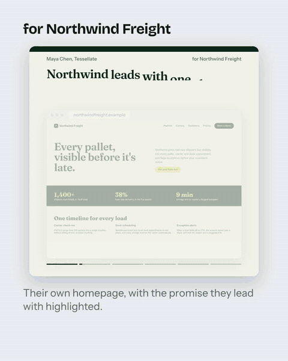
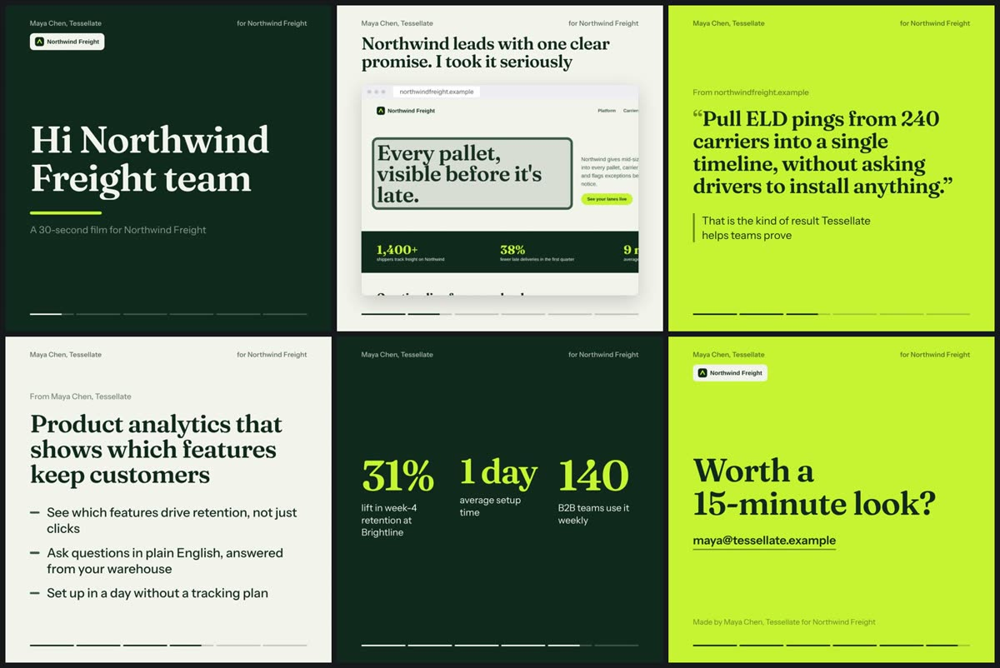
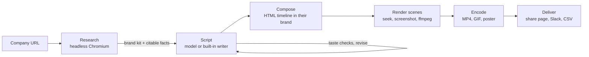
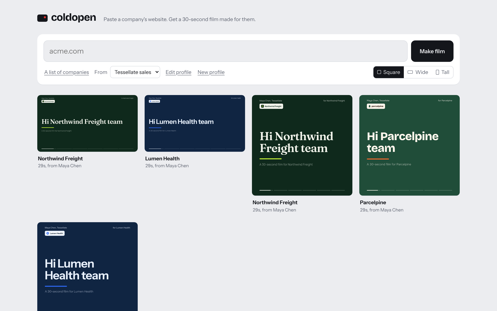

# coldopen

**Paste a company's website. Get a 30-second film made for them.**

coldopen is an open-source agent for personalized video outreach. Give it a prospect's URL and it reads their homepage, matches their brand (fonts, colors, logo), writes a short script grounded in what's actually on their site, and renders an on-brand MP4. It also produces the GIF an outreach email embeds and a share page to link to. It runs free on your own machine.



## See it work

```bash
pnpm install
pnpm film https://acme.com --profile profiles/sales.example.json
```

About a minute later:

```
Acme (acme.com), 29.2s square film
  film     films/acme.com-3f2a1c/film-square.mp4
  gif      films/acme.com-3f2a1c/preview.gif      <- paste into an email
  poster   films/acme.com-3f2a1c/poster.jpg
  sheet    films/acme.com-3f2a1c/contact-sheet.jpg
```

Each film is six scenes:

1. **Hook:** greets the company by name, on their own colors.
2. **Their homepage:** a screenshot of their site, zooming in on the promise they lead with and highlighting it.
3. **A fact from their site:** quoted verbatim (often a number), set in their typeface.
4. **The pitch:** what you offer, tailored to them.
5. **Your proof:** shown word for word from your profile.
6. **One clear ask.**



## Why it doesn't look like a template

- **It uses their brand, not yours.** coldopen opens the site in headless Chromium and reads what is actually rendered:
  - colors, weighted by how much of the screen they cover and how prominent the buttons are
  - the real @font-face files behind the headline, embedded into the film
  - the logo from the header
  - the hero screenshot, plus the exact position of the headline on it
- **It can't invent facts.** The model writes short lines and picks pointers: which fact from the site to feature, and which of your proof points to show. The fact and the proof are then rendered from their sources, so a hallucinated statistic has nowhere to appear. Any number in the model's own lines must exist in the site or your profile, or the line is rejected.
- **Taste is written down and enforced in code.** Word limits per line, a banned list of AI-slop phrases ("unlock", "seamless", "revolutionize"…), no flattery, no exclamation marks, and the company must be named. Violations are sent back to the model verbatim for a rewrite, up to four drafts. Any line it still gets wrong is swapped for the built-in writer's version of that line, and its good lines are kept. A film never ships with a violation. See [docs/TASTE.md](docs/TASTE.md).
- **Readable by construction.** Every foreground color is solved against its background to meet WCAG AA (4.5:1 for text, 3:1 for accents). The brand's own colors are tried first, then the same hue shaded until it passes. A property test checks this against 500 random brand palettes on every run.
- **Nothing overflows.** Text is measured after the brand fonts load and shrunk to fit its line budget, in square, wide and tall formats. Any line that still doesn't fit is reported by the QA pass.

## How it works



**A film is a web page on a timeline.** Every scene is HTML and CSS with paused animations. `__seek(t)` sets every animation to exactly time _t_, Chromium screenshots the frame, and ffmpeg encodes. Frames are pixel-identical no matter when or where they're rendered, which is what makes the next part possible.

**Rendering is crash-proof.** Films run on [unkillable](https://github.com/tiwaker9404/unkillable), a durable-execution runtime on Postgres. Each step (research, every script draft, compose, every scene, encode) is checkpointed. If a renderer dies 46% of the way through, the next worker replays research, script and finished scenes from the journal and renders only the rest. [A chaos test](test/chaos/film-crash.test.ts) does exactly that to a real worker process on every CI run, then checks that no finished scene was rendered a second time. Only the scene that was in progress at the kill is redone.

## Run it for your team

```bash
docker compose up --build       # web app, API, renderer and Postgres on http://localhost:8080
```



- **Web app.** Paste one URL or a list of hundreds, pick who it's from, and watch films render live. Each film has a share link and a copy button for the email GIF (`<a></a>` pointing at the share page).
- **Batches.** `POST /v1/batches` with a list of URLs, then download `results.csv` with share, GIF and video links per prospect, ready for a CRM or a sequencer like Apollo, Outreach or HubSpot.
- **Slack.** Mention `@coldopen acme.com` in any channel and the finished film is posted back into the thread. Requests are signature-verified, and Slack's retries never start a second film. See [docs/SLACK.md](docs/SLACK.md).
- **API.** Everything above is a REST call. OpenAPI docs are served at `/docs`; set `API_KEYS` to require a bearer key.
- **Scale.** Run more renderers with `docker compose up -d --scale worker=4`. Each worker claims films with `FOR UPDATE SKIP LOCKED` and holds a heartbeated lease; finished work is never redone.

## Writing scripts with a model (free)

Without a model, the built-in writer makes plain but always-correct scripts. For natural copy, point coldopen at any OpenAI-compatible API. Two free options work well:

| Setup                            | Model                 | Quality                                        | Notes                                |
| -------------------------------- | --------------------- | ---------------------------------------------- | ------------------------------------ |
| **Groq free tier** (recommended) | `openai/gpt-oss-120b` | Best: passes the taste checks in 1 to 2 drafts | No card. About 1,000 requests a day. |
| **Ollama on your laptop**        | `qwen2.5:7b`          | Good: occasionally needs a built-in line       | Private, offline, unlimited          |

```bash
# Groq, with local Ollama as the fallback when Groq's daily limit runs out
export LLM_BASE_URL=https://api.groq.com/openai/v1 LLM_API_KEY=gsk_...   # key from console.groq.com
export LLM_FALLBACK_MODEL=qwen2.5:7b                                    # Ollama, used on 429s and outages
pnpm film https://acme.com --model openai/gpt-oss-120b
```

Keep keys in the environment, not on the command line, so they never show up in terminal output or shell history. The server reads the same variables, plus `LLM_PROVIDER=openai`.

- **Structured outputs.** The script's schema is sent as a strict JSON Schema (`response_format: json_schema`), so models that support constrained decoding (gpt-oss on Groq, recent Ollama) can only return the right shape. Endpoints without it are detected on the first call and get plain JSON mode instead.
- **Fallback chain.** A rate limit, outage or timeout moves to `LLM_FALLBACK_MODEL` instead of failing the film, so a 500-prospect batch survives a free tier's daily cap. A wrong model name or key fails once with a hint, rather than being retried.

## Two presets

Each sender profile is a small JSON file you write once ([examples](profiles/)):

| Preset      | Who it's for                       | The film says                                                                                               |
| ----------- | ---------------------------------- | ----------------------------------------------------------------------------------------------------------- |
| `sales`     | Founders, SDRs, account executives | "Here's what I noticed about your business, and why what I sell fits it."                                   |
| `candidate` | Job seekers                        | "Here's what you build and who it serves, and how my strengths help." The ask is a conversation, not a job. |

## Quality, measured

```bash
pnpm test         # 98 tests: runtime, extraction, render QA, pipeline resume, API, Slack, model path
pnpm test:chaos   # SIGKILL a real renderer mid-film; a new one must finish without redoing scenes
pnpm evals        # 72 quality checks across 12 evals on 3 fixture companies x 2 presets
```

[Evals](evals/results.md) grade the output, not the code:

- **Brand fidelity:** the extracted color matches within an OKLab distance of 0.03, and the right typeface and logo are found.
- **Grounding:** the quote shown on screen appears verbatim on the homepage.
- **Taste:** every rule in [docs/TASTE.md](docs/TASTE.md) holds.
- **Design:** WCAG contrast, no text overflow in any of three formats, and pixel-identical re-renders.

Run `pnpm evals --model <name>` to grade a real model's scripts the same way.

The fixture companies in [fixtures/sites](fixtures/sites) (a freight platform, a health-tech startup and an e-commerce returns tool) are fictional, but they're built like real sites: web fonts, stat tiles, testimonials and CTAs.

## Security

- **Network guard.** The research browser refuses private, loopback and link-local addresses: navigation, redirects and every sub-request. A hosted instance can't be pointed at cloud metadata or internal services. Allow them only for local development (`ALLOW_PRIVATE_NETWORKS=true`). The CLI allows them, since it's your own machine.
- **Private by default.** Share pages and their media are public by unguessable ID, and only once a film has succeeded. Research data (`kit.json`) stays behind the API key.
- **Defense in depth for hosted use.** If you host coldopen for untrusted users, also run workers behind an egress firewall. A DNS-rebinding host can resolve differently for the guard than for Chromium; the firewall closes that gap.

## Limits, stated plainly

- Sites that block automated browsers (some Cloudflare and Akamai configurations), or that show a login wall, can't be researched. The film fails with a clear message instead of guessing.
- Rendering takes about 50 seconds per 30-second film on two CPU cores. Batches of hundreds are an overnight job on one machine, or minutes with more workers.
- The built-in writer is correct, not charming. Use a model for copy you'd send to your best prospects.
- Films are silent by design. Most outreach video autoplays muted.

## Built with

- **Runtime:** Node 24 running TypeScript natively, with TypeScript 7 for type checking.
- **Server:** Fastify 5, with Zod 4 for validation, structured model output and OpenAPI.
- **Data:** Postgres through postgres.js.
- **Rendering:** Puppeteer and Chromium, plus ffmpeg (H.264 and GIF palette generation).
- **Web app:** React 19, Vite 8 and TanStack Query.
- **Tooling:** Biome 2 and Vitest 5. The launch film in [launch/](launch/) is itself rendered by the same engine.

```
src/brand/     research: extraction, color science, network guard
src/script/    taste rules, checks, writer, storyboard
src/render/    composition (HTML timeline), theme, frame renderer
src/runtime/   durable execution (from unkillable)
src/api/       REST API, share pages, Slack events
src/cli.ts     one-command films and CSV batches
dashboard/     web app
evals/         quality evals
```

## License

MIT
